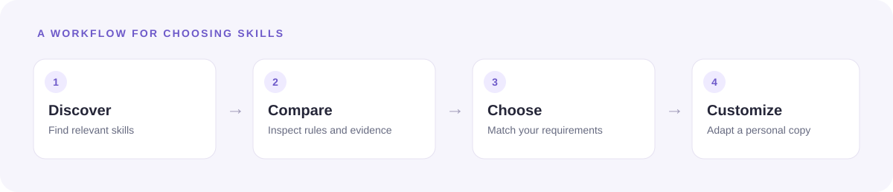
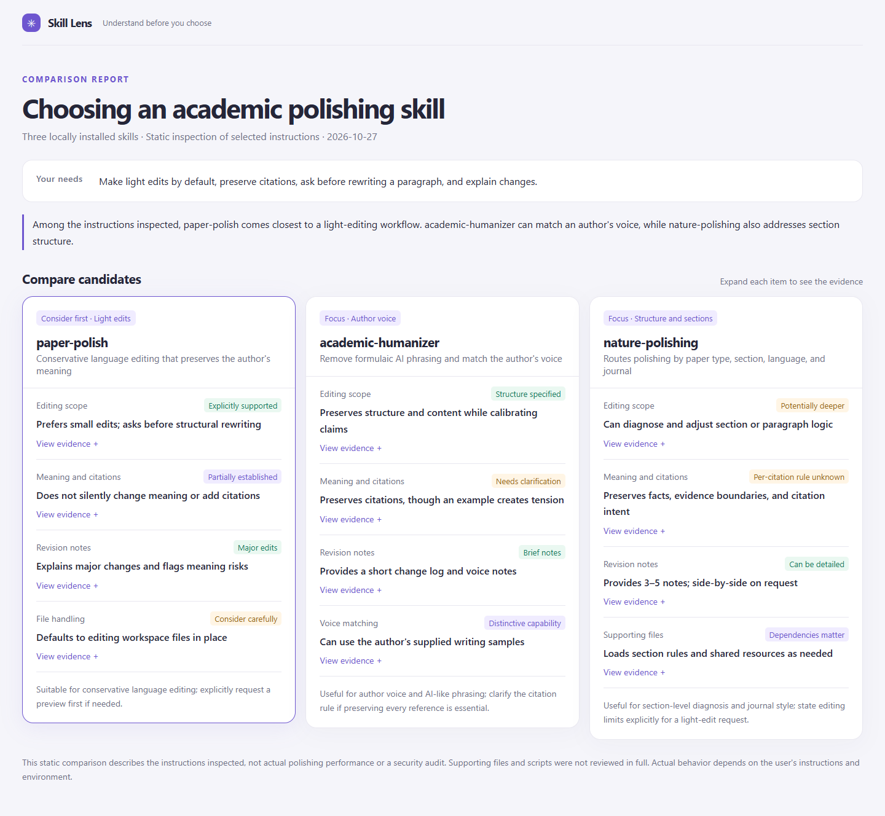

<div align="center">

# Skill Lens

**Understand the skills you find. Choose the one that fits. Make it yours.**

An agent skill for discovering, comparing, and customizing other agent skills.

[How it works](#how-it-works) · [Quick start](#quick-start) · [Example report](#example-report) · [How to use](#how-to-use) · [Limitations](#limitations)

</div>

---

You search for an academic writing skill and find three promising options. One rewrites sections, another makes conservative edits, and a third requires extra tools. Their names sound similar; their workflows are not.

**Skill Lens reads the actual instructions and relevant supporting files, explains the differences with evidence, and helps you adapt a skill to your own needs.**



## What it does

🔎 **Discover.** Find candidates in local skill directories or, when the agent has network access, from public sources. Identify the actual skill files rather than relying on repository descriptions alone.

⚖️ **Compare.** Examine scope, workflows, dependencies, output, and behavioral boundaries. Trace important findings to source files, and distinguish unknowns from conflicts.

🎯 **Match your needs.** Describe the skill you want in your own words. Skill Lens compares candidates against the requirements you actually give it, or gives a neutral comparison when you simply want to understand the differences.

🛠️ **Customize.** Select a base skill and borrow useful ideas from others. Get a reviewable plan with the requirement, source, proposed change, and trade-offs. Create a personal copy when requested.

🗂️ **Maintain.** Record the source and reasons for personal changes, and use available baseline and upstream versions to review updates. User-supplied feedback can inform suggestions.

## Example report

Skill Lens can produce a self-contained HTML report with one card per candidate. Expand a finding to see its source and reasoning.



> **About this example:** The report compares instructions from three locally installed academic polishing skills. It is a static comparison, not a benchmark or a claim that one skill produces better results. The sample paths are illustrative and may not exist on your computer.

The [example data](examples/academic-comparison.json) and [generated HTML](examples/academic-comparison.html) are included. GitHub displays HTML files as source; download the report or open it from a local checkout to view the cards.

## Quick start

### Install for Codex

Clone the repository, then copy the `skill-lens` directory into your Codex skills directory:

```bash
git clone https://github.com/TaoLbr1993/skill-lens.git
mkdir -p ~/.codex/skills
cp -R skill-lens/skill-lens ~/.codex/skills/skill-lens
```

The destination should not already exist; inspect any existing installation before replacing it. For other agents that support `SKILL.md`, follow that agent's local skill installation instructions. Some clients may need a refresh or a new session to discover the skill.

**Requirements:** an agent capable of reading skills and source files. Generating the optional standalone card report requires Python 3; the renderer uses only the Python standard library.

### Try a comparison

```text
Use $skill-lens to compare these three academic writing skills:
<skill A>, <skill B>, and <skill C>.

I want a skill that makes light edits, preserves citations, and asks before
rewriting a paragraph. Explain the trade-offs and show the source evidence.
Do not modify the candidate skills; you may generate a card report.
```

You can also start without candidates:

```text
Find and compare skills that can extract a person's viewpoints from
interviews. I want traceable sources and a clear distinction between
what the person said and an inference.
```

## How it works

1. **Understand the request.** Start from your candidate list or your free-form description of the skill you want.
2. **Find and inspect.** Locate `SKILL.md` and relevant references, scripts, manifests, or shared resources. Report anything inaccessible or not inspected.
3. **Explain the differences.** Compare the behaviors and trade-offs that matter for your request, with evidence for consequential findings.
4. **Present the result.** Deliver a concise comparison and, when file creation and preview are available, a card-style HTML report by default.
5. **Adapt on request.** Choose a base; propose specific changes informed by your requirements and other candidates; preview or create a personal version as requested.

You can ask only for a comparison. A full discovery or customization workflow is not required.

## More examples

<details>
<summary><strong>Compare local skills without a fixed use case</strong></summary>

```text
Use $skill-lens to compare these local skills. What are their actual
workflows, required dependencies, output formats, and limitations?
Link the rules that support the important differences.
```

</details>

<details>
<summary><strong>Customize from multiple candidates</strong></summary>

```text
Use $skill-lens to propose minimal changes to skill A, informed by skill B's
revision notes and skill C's voice matching. Show the source for each idea,
any conflicts, and a before/after preview. Do not modify files yet.
```

</details>

<details>
<summary><strong>Turn selected feedback into suggestions</strong></summary>

```text
Use $skill-lens to analyze the feedback excerpts below. Distinguish lasting
preferences from one-off requirements and existing rules that were ignored.
Suggest changes without storing the conversation text.
```

</details>

## What the comparison means

| Finding | Interpretation |
|---|---|
| Explicitly supported | The inspected source directly describes the behavior. |
| Partially supported | Some, but not all, of the requirement is supported. |
| Conflicting | An inspected rule conflicts with the stated requirement or another rule. |
| Not established | The inspected material does not settle the question. It does not prove the feature is absent. |

The report is based on the material the agent could inspect. **It does not prove execution quality, security, cost, or reliability.** A separate trial is needed to evaluate behavior in practice.

## Project structure

```text
skill-lens/
├── skill-lens/
│   ├── SKILL.md                         # Entry point and step-by-step workflow
│   ├── assets/report-template.html      # Self-contained card-report template
│   ├── references/                      # Comparison, customization, and reporting guides
│   └── scripts/render_report.py         # JSON-to-HTML renderer
├── examples/                            # Sample comparison and report
└── docs/images/                         # README illustrations
```

## Limitations

- Search coverage depends on the agent's available tools, network access, and accessible sources.
- Skill instructions and their supporting files are treated as untrusted source material. A static review is not a security audit.
- The report renderer displays findings prepared by the agent; it does not independently inspect skills or assess their quality.
- History analysis uses material the user provides or specifically identifies. It does not automatically collect chat logs.
- Personal-version maintenance is assisted on request. Automatic upstream synchronization and performance benchmarking are not implemented.
- Check applicable licenses before copying or redistributing text or code from another skill.

## License

[MIT](LICENSE)
